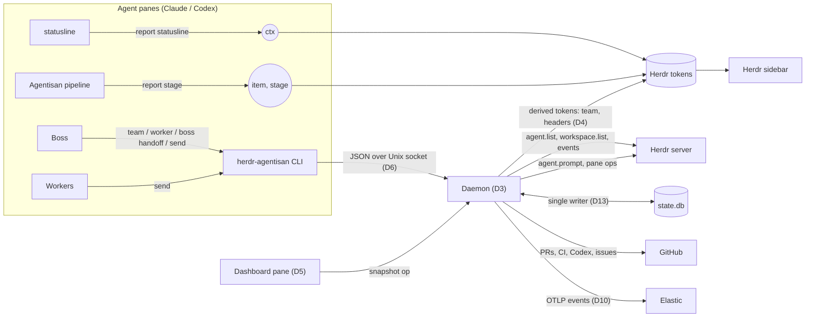

# ADR-001: herdr-agentisan — boss-led workflow plugin for Herdr

Oct 9, 2026 · @abanna

herdr-agentisan is a Go CLI and daemon, packaged as a Herdr plugin, that executes and observes a boss-led Agentisan workflow. The boss keeps every workflow decision. The plugin owns lifecycle, observation, presentation and durability.

## Status and metadata

| Field | Value |
| --- | --- |
| Status | Accepted 2026-10-09, with amendments A1 to A29 and A31 (see [Amendments](#amendments)). Where an amendment and the text above it disagree, the amendment wins |
| Deciders | Alexander Banna |
| Design issue | NERD-5244 |
| Build project | P-NERD-16 |
| Baseline | Phase 1 merged: NERD-5240 to 5243, PRs #4 to #7, main at fc5cf7a |
| Supersedes | DR 001 draft, 2026-10-09 |
| Herdr version | Pinned per D2; facts verified against herdr src at v0.9.3 |

Each decision carries an ID (D1 to D12). A later ADR may supersede a single decision, for example "supersedes ADR-001 D7", without reopening the rest.

## Context

The workflow works, but it is held together by untested scripts that fight each other. Nothing supervises it, and it cannot be reused on another project.

Today a boss agent backed by Agentisan directs specialist workers in Herdr. The groups are coders, precheck, QA, Codex review triage, research, clerk and debugger. Workers take direction from the boss. The boss and workers hand off and reload at 55 to 65 percent context usage.

The pieces that hold it together:

- herdr-dashboard-v12.py renders the team dashboard and pushes sidebar tokens.
- herdr-status.sh builds the PR, CI, Codex and issue header.
- hs.sh reports item and stage.
- dashboard-tab.sh opens the dashboard tab.
- A pkill herdr agent attach workaround is bound to prefix+b as a back key.
- btop runs on a popup key.

### Problems this ADR solves

1. Two pushers writing the same token key overwrite each other, because the last write wins.
2. Context rotation depends on someone noticing the percentage. No process watches it.
3. Nothing supervises long-running work. A startup hook runs once and is never restarted.
4. Shell and Python cannot be tested at the behavior level, and every handoff invariant lives there.
5. Paths, worker counts and commands are hard-coded, so a second project means copying the scripts.

### Goals

- Preserve today's behavior, with the boss in charge of the workflow and of the team.
- On request, the boss builds out its team, adds and removes workers based on load and context, and hands its own session to a new boss.
- Make the workflow reusable across projects through configuration alone.
- Make context rotation lossless for the boss and for workers.
- Use Agentisan for every workflow, and tdaddy in every Go project.
- Reach the target wireframe: a left sidebar by project, and per project a boss tab plus seven group tabs (coders, qa, precheck, clerk, research, codex, debugger). The boss tab has the dashboard above the boss terminal.

### Non-goals

- Replacing Agentisan's planning, assignment or review pipeline.
- A general messaging service, or a REST or gRPC API.
- Shipping the target layout first. The plugin is built against today's ~/.config/herdr/config.toml and today's layout of ◆ group spaces plus a boss space. The layout comes last (D5).

## Verified constraints

Every decision below is shaped by these Herdr facts, verified against the herdr source at v0.9.3. Herdr is pre-1.0, so D2 pins the version and the daemon refuses to run against a protocol it has not been verified on.

| Constraint | Detail | Consequence |
| --- | --- | --- |
| Token precedence | Tokens are stored per target by key, and the last write wins across `--source` values (src/metadata_tokens.rs) | Each key has exactly one writer (D4). The Python pusher stops at cutover, key by key |
| Token limits | A value holds 80 characters at most, a report carries 16 keys, and a target holds 32. A missing token removes its line | Token formats are budgeted in the token contract, and expiry is visible |
| Colour rules | `gt` and `lt` rules match only values that parse completely as a number | `$ctx` is a bare integer such as `42`, never `42%` |
| `$team` rules | The rules match on ⚠ and ⟳ | The `$team` format is frozen: `N · ◐w ●i[ ⚠b][ ⟳r]` |
| Startup hooks | `[[startup]]` runs on server start and live handoff only, not on plugin link or enable. Herdr does not supervise it | The daemon needs a manual start action. Verification never restarts the user's server |
| Keybindings | Plugins cannot ship default keybindings | Keys live in the user's config.toml and are applied by `config apply` (D9) |
| Pane identity | `HERDR_PANE_ID` reaches shells under Claude Code (checked: `w14:p1`) | Agents can report their own state (D4) |
| Claude context | `~/.claude/statusline.sh` already reads `.context_window.used_percentage` | The Claude context signal exists today |
| Codex context | No equivalent signal has been verified | Open item: Codex rotation is blocked on a spike |
| Existing code | `plugin.CallTimeout` (5s) is in internal/plugin/ping.go. `herdr.Client.Call` is generic (internal/herdr/herdr.go). `herdrtest.Start` is a fake server | Every herdr call gets a per-call timeout, and every test runs against herdrtest |

## Decision drivers

These drivers break ties between the decisions below, in this order.

1. **The boss owns the workflow and the team.** Every spawn, retire and handoff is a boss command. Agentisan must still work as a single session.
2. **One source of truth for each piece of data.** Each piece of data has one writer, and state comes from the component that knows it rather than being inferred.
3. **Behavior is testable first.** Every invariant has a given/when/then test against herdrtest before code is written.
4. **Boring architecture.** Files and Unix sockets come before services, and polling comes before a protocol, until data shows a gap.
5. **Independent of layout.** Nothing is coupled to the ◆ spaces that the 8-tab layout will replace.
6. **The user's session is never disrupted.** No step restarts the user's Herdr server, and the scripts stay as a pinned fallback until the Go path has proven itself.
7. **The toolchain is mandatory.** Agentisan runs every workflow, and tdaddy is used in every Go project.

## Decisions

Diagram added at acceptance in place of the draft's missing figure. It already reflects amendments A1 (`state.db`) and A2 (any agent sends messages with `send`).

Agents push their own state. The daemon is the only component that polls Herdr and GitHub, writes derived tokens and serves the dashboard. Every workflow decision still goes through the boss.

### D1. The boss owns the team; the daemon executes its commands

The Agentisan boss owns planning, assignment, messaging, blocker resolution, and the size and makeup of its team. It adds, removes and replaces workers at will, based on load and context, and it hands off its own session. The daemon executes those commands (D11) and observes. It never spawns, retires or replaces an agent on its own. At context thresholds it notifies the boss, and at the ceiling it also alerts the user (D7).

*Rationale:* Agentisan is dogfooded and must still work in a single session. A daemon that resized the team itself would become a second orchestrator, and a boss that cannot resize its team cannot respond to load.

### D2. Runtime: a single Go binary behind a Herdr plugin manifest

`herdr-agentisan` is one Go binary. `herdr-plugin.toml` registers its `[[startup]]` hook, `[[actions]]` and `[[panes]]`. `task install` puts the binary on PATH, and `task plugin:link` links the manifest. Prebuilt release assets come later, once there is a second user. The supported Herdr version is pinned in the repo. The daemon reads the server's protocol version at startup and exits with a clear error if it has not been verified.

*Rationale:* Go is chosen for behavioral testability, typed configuration validation and a long-running supervisor. Shell and Python cannot test the handoff invariants with confidence. The existing scripts remain a pinned fallback, and each is retired only when its Go replacement passes the same acceptance tests.

### D3. The daemon is the single collector and the only writer of derived state

One daemon runs per Herdr server. It is a reconcile loop:

- On start, it rebuilds its model from `agent.list`, `workspace.list` and the runtime state files.
- It then polls about every 3 seconds and also subscribes to focus events.
- It is the only writer of derived tokens (D4), of the runtime state files (contracts), and of collected external data such as PRs, CI, Codex review and issues. That data is cached and fetched on its own interval.
- It serves snapshots over its Unix socket (D6). Dashboards read those snapshots and never poll Herdr or GitHub themselves.

Lifecycle:

- `daemon start` spawns a detached `daemon run` with setsid, logs to a size-capped file under `HERDR_PLUGIN_STATE_DIR`, and exits.
- A flock'd lock file enforces a single instance. A second `run` that cannot take the lock exits 0.
- The `[[startup]]` hook calls `daemon start`. The `daemon-restart` action covers linking and manual recovery, because linking does not fire startup hooks.
- The daemon exits when the Herdr socket disappears or its inode changes. The next server start launches a new one.
- A crash costs only the restart, because state is rebuilt on start.

### D4. State is pushed by the component that knows it, and each key has one writer

The agent pushes its own context: `report statusline` sends `$ctx` from Claude's statusline. Agentisan pushes item and stage: `report stage` is called on every pipeline step transition. The daemon pushes anything derived, such as `$team` and any header tokens. No component infers state from working directories or by scraping files. During cutover, the Python pusher stops writing a key in the same change that introduces its new writer.

*Rejected:* mapping each pane's `foreground_cwd` to a `generations/<ticket>/<slug>/gNNN` worktree and reading `.agentisan/state.json`. That breaks when an agent changes directory. It also couples the plugin to a private file layout, and it does not work for Codex.

### D5. Presentation reads a model that is independent of layout

The daemon keeps one domain model: project → group → logical worker → current pane. A target resolver maps the model onto the current layout. Today that means the ◆ group spaces and a boss space. The 8-tab layout later replaces only the resolver.

Presentation components:

- **Dashboard:** a Go bubbletea pane placed with `[[panes]] placement="split"`, rendered from daemon snapshots. Its header shows project colour, PRs with CI, Codex 👍 and merge state, issues, slots, and boss ctx and runtime. Group boxes show each agent's status, model, ctx, item and stage.
- **Jump:** clicking a group box or pressing Enter runs `agent.focus` and zooms the pane.
- **Back:** returns to the previous pane from the daemon's focus history and un-zooms. It replaces the `pkill` workaround on prefix+b.
- **Search:** `/` in the dashboard and prefix+/ anywhere fuzzy-match agents and spaces. Herdr's built-in Go To is evaluated first and used if it is enough.
- **btop:** stays a popup key.

Sidebar grouping through header tokens carried by the first agent in each group is deferred. It breaks when that agent rotates out, and the dashboard may make it unnecessary.

### D6. Control interface: the CLI plus JSON over a local Unix socket

Every operation is a CLI command. The daemon exposes JSON request and response messages over a Unix socket in the plugin state directory, for snapshots, reports and actions. Workflow logic is independent of transport. The plugin's socket is separate from Herdr's session-control socket. REST and gRPC are deferred until a concrete client needs them.

### D7. Context levels inform the boss; the boss decides rotation

The daemon reports every agent's context level to the boss at three levels. The boss decides what happens next: rotate the worker, let it finish its unit first, reassign the work, or retire the worker.

| Level | Context used | Daemon does | Boss normally |
| --- | --- | --- | --- |
| Soft | 55% | Notifies the boss | Lets the worker finish its unit, then rotates it |
| Hard | 65% | Notifies the boss again | Rotates the worker now |
| Ceiling | 75% | Notifies the boss and alerts the user | Must act. The daemon still never acts alone |

The thresholds are configurable for each project and role, with defaults of 55, 65 and 75. The boss also sees load (queued work, idle workers, open slots) through `team status`. The same commands therefore serve both rotation and scaling.

Worker rotation:

1. The boss runs `worker spawn --replaces <id>`. The daemon opens a new pane under Agentisan, bound to the same logical worker ID.
2. The boss directs the old worker to write its handoff through Agentisan's handoff mechanism.
3. The new session reads the handoff and acknowledges.
4. The daemon drains any queued messages (D8) into the new session.
5. The boss runs `worker retire <old pane>`, and the daemon closes the old pane.

Boss self-handoff, started when the boss runs `boss handoff`:

1. The daemon opens a new pane in a split beside the boss and launches a new boss under Agentisan.
2. The old boss writes its handoff.
3. The new boss reads the handoff and acknowledges to the daemon.
4. The daemon closes the old boss's pane, and the new boss takes over the logical boss ID.

Workers keep running during a boss handoff, and messages to the boss queue in its inbox. If the new boss does not acknowledge within the timeout, the old boss stays in charge, the new pane is closed, and the user is alerted. There is always exactly one boss in charge.

### D8. Message durability, gated by a test

A message delivered into a pane that is being replaced has no receiver. The test is written first: given three messages queued during a handoff, when the replacement session binds, then each is delivered exactly once.

If the existing mechanism fails that test, the fix is an append-only inbox for each logical worker in runtime state. Each message has an ID, and a set of delivered IDs makes dispatch idempotent. That is a file, not a service. If the existing mechanism passes, the inbox is not built.

### D9. Configuration is a versioned contract with defined precedence

The plugin config is `herdr-agentisan.toml` in `HERDR_PLUGIN_CONFIG_DIR`. Its `schema_version` must be one the binary supports. Precedence runs from built-in defaults, to shared config, to project config, to command-line flags. Tables deep-merge, while scalars and lists replace. `config resolve` prints the resolved values and the layer each one came from.

Project profiles define the project's name, repo path, colour, GitHub repo, groups with a default worker count and a slot cap for each group, agent command and model, verification commands, integrations and rotation thresholds. Secrets are environment variable references, never values.

Canonical role instructions stay in agentisan-skills. Configuration holds only overlays.

Because plugins cannot ship keybindings, `config apply` writes a marked block of `[[keys.command]]` entries into the user's Herdr config.toml and never touches anything outside that block.

The separate config repo, with `projects/<name>/` directories and a generated config.toml, comes last.

### D10. Workflow events go to telemetry from the first daemon release

The daemon emits status transitions, stage changes, threshold crossings, handoff steps and rotations through the existing `internal/telemetry` OTLP exporter into Elastic. The debugger agent queries those events. The debugger tab is a later issue, but the event trail exists when rotation is built.

### D11. The boss controls its workforce through daemon commands

Every team change is a CLI command that the boss calls through an Agentisan skill. The daemon executes the command over its socket (D6). Asking the boss to build out its team runs `team up`.

| Command | What the daemon does |
| --- | --- |
| `team up [--project p]` | Fills each group up to its default count from the project profile. It only fills empty slots, so running it twice leaves the same team |
| `team status` | Returns every worker's group, status, context, item, stage and idle time, plus open slots |
| `worker spawn --group g [--count n] [--model m] [--replaces id]` | Opens new panes under Agentisan in the group's target, binds logical IDs, and returns them |
| `worker retire <id> [--after-handoff]` | Closes the worker's pane. With `--after-handoff`, it first waits for the worker's handoff. Undelivered messages return to the boss |
| `boss handoff` | Runs the boss self-handoff in D7 |

Each group's slot cap in the profile bounds machine load. The boss scales freely below the cap, and the cap changes only through configuration. A spawn above the cap is refused, and the error names the cap. Every command returns JSON and is idempotent on the logical ID, so the boss can retry safely.

### D12. Agentisan runs every workflow, and tdaddy is required in Go projects

Every session the daemon launches, boss or worker, starts through Agentisan with its workflow skills loaded. A profile whose agent command bypasses Agentisan fails `config resolve`.

Agentisan enforces tdaddy in Go projects through its project rules. The daemon double-checks at spawn time: in a repo with a `go.mod`, `team up` and `worker spawn` refuse to launch unless tdaddy is configured, and the error explains how to configure it.

## Contracts

Four contracts are versioned. Changing one of them requires a superseding ADR.

### Token contract

Every key has exactly one writer. Every report uses the source `agentisan`.

| Key | Writer | Target | Format | TTL |
| --- | --- | --- | --- | --- |
| `ctx` | `report statusline` (Claude). Codex adapter to come | Agent pane | Bare integer from 0 to 100, rounded | 180,000 ms, 3 times the statusline refresh |
| `item` | `report stage` | Agent pane | Ticket ID such as `NERD-5245`, 80 characters at most | None, or the longest Herdr allows. The token leaves with its pane |
| `stage` | `report stage` | Agent pane | Agentisan pipeline step name, 80 characters at most | Same as `item` |
| `team` | Daemon | Group target from the resolver | Exactly `N · ◐w ●i[ ⚠b][ ⟳r]` | About 9,000 ms, 3 times the poll |

Budget: an agent pane carries 3 keys and a group target carries 1, well under the 16-per-report and 32-per-target limits. A new key must be added to this table before it ships.

### Report commands

Both commands are silent on stdout, finish quickly, and always exit 0. They do nothing when `HERDR_PANE_ID` or `HERDR_SOCKET_PATH` is unset, or when their input is missing or malformed. Every herdr call uses `CallTimeout`. Errors are sentinel errors wrapped with `%w` and are written only to the debug log.

- `herdr-agentisan report statusline` reads Claude's statusline JSON on stdin and pushes `ctx`. It is wired in with one line in `~/.claude/statusline.sh`: `herdr-agentisan report statusline <<<"$input" >/dev/null 2>&1 &`.
- `herdr-agentisan report stage --item <id> --stage <step>` is called by Agentisan on every pipeline step transition, and pushes `item` and `stage`.

### Runtime state

Runtime state lives under `HERDR_PLUGIN_STATE_DIR` and is never mixed with configuration. The daemon is its only writer, and every file carries a `schema_version`.

| File | Contents |
| --- | --- |
| `daemon.lock` | flock target and PID, enforcing a single instance |
| `daemon.log` | Capped at 10 MB, with one rotated file |
| `workers.json` | Logical worker ID mapped to project, group, current pane ID and generation |
| `focus.json` | A ring of the last 32 focused panes, used by Back |
| `inbox/<worker-id>.jsonl` | Only if the D8 test fails: message ID, sender, body and a delivered flag |

The socket protocol is a JSON request `{"v":1,"op":…,"args":…}` and a response `{"ok":bool,"data"|"error":…}`. The operations are `snapshot`, `report`, `action` and `health`.

### Handoff invariants

Each invariant is a named acceptance test.

1. **I1:** A worker's logical ID is unchanged across a replacement session.
2. **I2:** The `item` and `stage` after a handoff match those before it.
3. **I3:** Every message accepted before or during a handoff is delivered exactly once.
4. **I4:** Exactly one boss is in charge at all times. The old boss is retired only after the new boss has acknowledged a written handoff.
5. **I5:** The daemon never spawns, retires or replaces an agent except on a boss command.
6. **I6:** At most one daemon runs per Herdr server.
7. **I7:** No automated step or verification restarts the user's Herdr server.
8. **I8:** Every launched session runs under Agentisan, and no session in a Go project launches without tdaddy.
9. **I9:** Running `team up` twice leaves the same team as running it once.

## Consequences

The workflow becomes testable, reusable and lossless across rotations. The cost is a Go codebase and four contracts to maintain against a Herdr that has not reached 1.0.

### Positive

- Rotation becomes automatic, with a ceiling on context, and the handoff invariants are proven by tests rather than assumed.
- Token fights end, because each key has one writer.
- The 8-tab layout becomes a change to the resolver, not a rewrite.
- A second project needs only a profile, not copied scripts.
- The event trail exists before the riskiest feature, worker rotation, is built.

### Negative

- Four versioned contracts (tokens, runtime state, socket and configuration) need migration discipline.
- Herdr's plugin API is still changing before 1.0. Each Herdr upgrade means re-verifying the constraints table and bumping the pin.
- Agentisan gains a dependency, because step transitions must call `report stage`. If the binary is missing, `report stage` does nothing. Agentisan itself is unaffected.
- A daemon crash goes unnoticed until its tokens expire, about 9 seconds later. Nothing restarts the daemon automatically during a session.

### Risks and mitigations

| Risk | Mitigation |
| --- | --- |
| Dogfooding: a broken plugin takes down the boss that would fix it | Scripts stay as a pinned fallback until parity. `daemon stop` restores the scripts' behavior |
| An idle Claude agent loses `$ctx` if the statusline refreshes only on activity | Verified in the issue 1 live check. If the refresh is event-driven, the TTL is raised to cover idle periods. The daemon treats an expired `ctx` as unknown, never as below threshold. The one-writer rule stays intact |
| Codex workers have no context signal | A spike comes before Codex rotation. Until it lands, Codex workers rotate only when the boss directs it |
| A future Herdr upgrade changes token semantics | The daemon checks the protocol version at startup, and herdrtest fixtures are pinned to the verified version |

## Alternatives considered

Each alternative failed at least one decision driver.

| Alternative | Verdict | Why |
| --- | --- | --- |
| Configuration and scripts only | Rejected | Handoff invariants cannot be tested at the behavior level (driver 3), and nothing supervises long-running work |
| StructuPath herdr-conductor, which orchestrates a role-differentiated team as visible panes | Rejected as a base, studied for patterns | It would take orchestration away from the Agentisan boss (driver 1). Agentisan's generations already give each worker its own worktree |
| A third-party orchestration framework | Rejected | A migration with no demonstrated gap in the current workflow (driver 4) |
| The daemon infers item and stage from working directories and `state.json` | Rejected | Breaks when an agent changes directory, couples to a private layout, and does not work for Codex (driver 2) |
| Each dashboard polls Herdr and GitHub itself | Rejected | One set of pollers per project, rate-limit pressure, and two sources of truth (driver 2) |
| A messaging service built up front | Rejected | Replaced by D8: a test first, then a file-backed inbox only if the test fails (driver 4) |
| Sidebar project and group headers carried as tokens by the first agent in each group | Deferred | Breaks on rotation, and the dashboard may make it unnecessary (driver 5) |
| Build the 8-tab layout first | Deferred | The user chose plugin first with the current config. The resolver in D5 keeps that choice cheap to change |
| REST or gRPC control API | Deferred | No client needs it (driver 4) |
| The daemon autoscales or rotates workers on its own | Rejected | Team decisions belong to the boss (driver 1). The daemon supplies context and load through team status instead |

## Implementation plan

Work is built in 12 issues in P-NERD-16. Each issue is one generation, with no stacked PRs and a 1,000-line review gate. Worker rotation comes fifth, ahead of the dashboard polish, because rotation changes outcomes and the dashboard changes visibility. Issues 1 to 4 are rotation's prerequisites, and issue 4 is what lets the boss build out its team.

| # | Issue | Depends on | Retires | Done when (given / when / then) |
| --- | --- | --- | --- | --- |
| 1 | `report statusline` pushes `$ctx` | None | Python `ctx` push | Given a Claude agent at 42.6%, when the statusline fires, then its pane shows `ctx` = `43` as a bare integer. With the env unset, it exits 0 and makes no call. The token is gone within 180 s after the hook line is removed |
| 2a | Daemon lifecycle with an empty loop, and `CallTimeout` moved into a shared helper | None | None | Two concurrent `daemon start` calls leave one daemon (I6). The daemon exits when herdrtest restarts. `daemon-restart` works after a link. An unverified protocol exits with an error. The log is capped |
| 2b | Domain model, resolver, `$team`, telemetry events (D10), and the Python `$team` cutover | 2a | Python `$team` push | Given fake agents, each ◆ space receives the exact `$team` format. After the daemon is killed, the tokens are gone within about 9 s. Status events reach Elastic |
| 3 | `report stage` plus the Agentisan step-transition hook | 1 | hs.sh | Given a pipeline step transition, `item` and `stage` appear on the pane within 1 s. Both survive a `cd` and work from a Codex pane |
| 4 | Workforce commands (D11), their Agentisan skill, and the Agentisan and tdaddy preflight (D12) | 2b | Manual pane setup | Given a profile with 3 coders and 1 QA, when the boss runs `team up`, then 4 panes start under Agentisan in their groups and `$team` updates. A second `team up` spawns nothing (I9). `worker retire --after-handoff` closes the pane only after the handoff. A spawn in a Go repo without tdaddy is refused (I8) |
| 5 | Worker rotation: context notices to the boss and `worker spawn --replaces`, plus D8 if its test fails | 3, 4 | Manual rotation | Tests for I1, I2, I3 and I5 pass. Each level notifies the boss, and the ceiling also alerts the user. A live rotation on Assay keeps the assignment |
| 6 | Boss self-handoff: `boss handoff` | 4 | Manual boss reload | Tests for I4 pass. A new boss opens in a split and acknowledges, then the old boss's pane closes. If the new boss never acknowledges, the old boss stays in charge. Messages to the boss during the handoff are delivered once |
| 7 | Codex context spike, time-boxed to one generation | None | None | Either a verified Codex context source with a `report` adapter, or a written decision that Codex rotation is directed by the boss only |
| 8 | Dashboard rendering: bubbletea and the socket `snapshot` operation | 2b | herdr-dashboard-v12.py, dashboard-tab.sh | Group boxes render from the snapshot alone. Click or Enter focuses and zooms the agent |
| 9 | Dashboard header data: GitHub collection in the daemon | 8 | herdr-status.sh | The header shows PRs with CI, Codex 👍 and merge state, issues, slots, and boss ctx and runtime. GitHub is polled once per interval no matter how many dashboards are open |
| 10 | Back action | 2b | The `pkill` workaround on prefix+b | After a jump, Back returns to the previous pane and un-zooms. It works across 3 consecutive jumps |
| 11 | Search palette | 8 | None | If Herdr's Go To covers fuzzy matching of agents and spaces, it is bound and the issue closes. Otherwise `/` and prefix+/ open a popup that jumps on Enter |
| 12 | Debugger tab | 2b | None | The debugger agent answers "what happened to worker X in the last hour" from Elastic events |

The backlog holds four items:

- Sidebar grouping through header tokens. Revisit after issue 6.
- The 8-tab project layout: a `project up` command built with `layout.apply`, plus a resolver swap.
- The config repo, a generated config.toml and `config apply`.
- A chore to fix the Linear hook matcher so it fires on `mcp__claude_ai_Linear__*`. It can be done at any time.

### On approval

- [ ] Create the 12 issues and 4 backlog items in P-NERD-16, each linked as related to NERD-5244.
- [ ] Post the design notes on NERD-5244 (the wireframe mapping, verified constraints and decisions), then move it to Done.
- [ ] Update the project memory and runtime notes with the startup hook and token precedence facts.
- [ ] Write HANDOFF.md at the repo root and add it to `.git/info/exclude`.
- [ ] Start issue 1 with go-coding-workflow, confirming understanding before any code.

## Verification

Every generation passes the same gates. Live checks never restart the user's Herdr server (I7).

### Gates for every generation

1. Tests come first: each acceptance criterion and invariant is a test against herdrtest before implementation.
2. Run `GOTOOLCHAIN=go1.26.10 task check`, `task tidy` and `task modernize`.
3. Run `task tdaddy:impact`.
4. go-review: run Job 1 yourself, then Jobs 2 and 3 through a subagent.
5. validate-workflow passes, then the PR is opened.

### Live check for issue 1

1. Run `task install`, then add the statusline line by hand.
2. Within 60 s, `$ctx` appears with the 55 and 65 colours. `herdr pane get` shows a bare integer.
3. Leave the agent idle for 4 minutes and confirm `$ctx` is still present. This settles whether the refresh is time-driven.
4. Remove the line and confirm the token expires within 180 s.

### Live check for issue 2

1. Run `task plugin:link`, then invoke `daemon-restart`.
2. Stop the Python pusher and confirm `$team` updates on every ◆ space.
3. Invoke `daemon-restart` a second time and confirm there is still one daemon.
4. Kill the daemon and confirm the tokens expire within about 9 s.
5. The startup hook path is covered by a unit test, and is checked live at the next natural server restart.

### Live check for issue 4

1. In a Go project whose profile has 3 coders and 1 QA, ask the boss to build out its team. Confirm 4 panes start under Agentisan in their groups and `$team` updates.
2. Ask again and confirm nothing new spawns.
3. Ask the boss to drop to 2 coders. Confirm one coder writes its handoff before its pane closes.
4. In a scratch Go repo without tdaddy, confirm `worker spawn` is refused with instructions.

### Live checks for issues 5 and 6

1. Force a worker on Assay past 65%. Send it 3 messages during the handoff. Confirm the same logical ID, the same `item` and `stage`, and each message delivered exactly once.
2. On Agentisan, have the boss run boss handoff. Confirm the new boss opens in a split, acknowledges, and the old boss's pane closes. Then kill the new boss before it acknowledges, and confirm the old boss stays in charge.

## Open items

Five facts are still unverified. Each is assigned to the issue that settles it, and none blocks approval.

| Item | Settled in | If the answer is no |
| --- | --- | --- |
| Does Claude's statusline refresh on a timer, or only on activity? | Issue 1 live check, step 3 | Raise the `ctx` TTL. The daemon treats a missing `ctx` as unknown |
| Is the installed Herdr 0.9.2 or 0.9.3? The constraints were verified at 0.9.3 | Issue 2a | Re-verify the constraints table against the installed version before pinning |
| Can a token have no TTL, and does a closed pane take its tokens with it? | Issue 3 | `report stage` sends to the daemon over the socket, and the daemon writes `item` and `stage` with a TTL |
| Does Herdr expose a focus event stream (`pane.focused`) or only polling? | Issue 2a | The focus history is sampled on each poll, and Back is accurate to the poll interval |
| What signal reports Codex context usage? | Issue 7 | Codex rotation is directed by the boss only, and the decision is recorded as a superseding note on D7 |

## Amendments

Accepted 2026-10-09 after review. The text above is kept as proposed, apart from the status row and the diagram that replaced the missing figure. Each amendment below names the part it overrides, and where the two disagree the amendment wins. A later ADR can supersede a single amendment the same way it supersedes a decision, for example "supersedes ADR-001 A2".

### A1. New D13: runtime state lives in one SQLite database

*Overrides:* the runtime-state contract table, "runtime state files" in D3, and "D1 to D12" in the metadata section. The decisions now run from D1 to D13.

- **Location.** One file, `state.db`, under `HERDR_PLUGIN_STATE_DIR`, opened with `modernc.org/sqlite`. That driver is pure Go, so the binary stays static with no cgo.
- **Durability.** WAL mode with `synchronous=FULL`. Write volume is tiny, so FULL costs nothing.
- **Schema versioning.** Migrations are numbered, embedded in the binary, and tracked with `PRAGMA user_version`. The daemon refuses to start on a schema version newer than the one it knows.
- **One writer.** The daemon holds the only write connection. The CLI always goes through the daemon socket. The one exception is a read-only `doctor` command, and people and the debugger agent can also open the file read-only with `sqlite3`.
- **Retention.** Messages in the `delivered` or `failed` state, and finished handoffs, are deleted after 14 days. Elastic keeps the long-term history.
- **Tests.** Every test opens a fresh database in a temporary directory, alongside herdrtest. The database is never mocked.
- **Plain files remain** for two things only: `daemon.lock`, because flock needs a real file, and `daemon.log`, capped at 10 MB with one rotated file, because logs should not live in the database being debugged.

| Table | Holds |
| --- | --- |
| `workers` | Logical ID, project, group, current pane ID, generation, status, created and retired times |
| `messages` | ULID, recipient logical ID, sender, body, state (`queued`, `dispatching`, `delivered` or `failed`), attempt count, timestamps |
| `handoffs` | ID, logical ID, old pane, new pane, state (`pending`, `acknowledged` or `failed`), timestamps |
| `focus` | Recently focused panes, used by Back, capped at 32 rows |

This replaces `workers.json`, `focus.json` and `inbox/*.jsonl`. The four versioned contracts are now tokens, the SQLite schema, the socket, and configuration.

### A2. D8 is replaced: messages go through the plugin

*Overrides:* D8, and the "A messaging service built up front" row in Alternatives considered. *Clarifies:* I3, as described under the crash rule below.

Workers reach the boss today with `herdr agent prompt boss "…"`, which types text straight into whichever pane holds that name. Nothing queues it, so D8's test would fail by construction, and the inbox is built rather than gated.

- **Sending.** A sender runs `herdr-agentisan send <logical-id> <body>` over the daemon socket, addressing a logical ID rather than a pane or agent name. The daemon stores the message in `messages` and delivers it with `agent.prompt` to the recipient's current pane.
- **States.** A message moves from `queued` to `dispatching` to `delivered`. Its only other end state is `failed`, which the crash rule below sets.
- **Atomic rebind (I3).** Rebinding a logical ID to its replacement pane and draining that worker's inbox happen in one SQLite transaction.
- **Crash rule.** After a daemon crash, a row still marked `dispatching` is set to `failed` and returned to its sender. It is never redelivered, because the receiving pane has no way to discard a duplicate prompt.
- **What I3 guarantees.** "Exactly once" holds whenever the daemon does not crash in the middle of a dispatch, and that includes every rotation and handoff. If the daemon crashes during a dispatch, delivery becomes at most once: the message may or may not have reached the pane, and the sender is told it failed so it can decide whether to send it again.
- **Fallback.** `herdr agent prompt` stays available for when the daemon is down, but messages sent that way are not durable.

### A3. D3 lifecycle: the lock records the server, and a new daemon waits

*Overrides:* "A second `run` that cannot take the lock exits 0", in D3.

- **The race.** During Herdr's live handoff, the new server's startup hook can run `daemon start` while the old daemon still holds the lock, because the old daemon only notices the socket change on its next poll.
- **The fix.** The lock file records the PID and the inode of the Herdr socket. A new `run` that finds the lock held by a daemon bound to a different, stale inode waits for the lock, with a time limit, instead of exiting. A `run` that finds the lock held by a daemon bound to the current server still exits 0.
- **Event loss.** On `events_lost`, the daemon resubscribes and re-reads a fresh snapshot.
- **Socket path.** The daemon checks that its socket path is under 104 bytes. That is the macOS limit; Linux allows 108, and the plugin ships for both.

### A4. D2 pin: an explicit override

*Adds to:* D2.

An unverified protocol still stops the daemon with a clear error. Setting `HERDR_AGENTISAN_ALLOW_UNVERIFIED=1` lets it run anyway after a Herdr update, until the pin is bumped.

### A5. Token contract changes

*Overrides:* the token contract table.

| Key | Change |
| --- | --- |
| `item`, `stage` | TTL is 86,400,000 ms (24 h, Herdr's maximum), set again on every `report stage`. Without a TTL, a session that exits while its shell keeps the pane would leave stale values forever |
| `handoff` | New row for a key that already ships. The writer is `hready.sh` until worker rotation (item 5b) lands, then the daemon. The target is the agent pane. `$team`'s `⟳r` counts panes that carry it |
| Group and project headers | New daemon-written keys for sidebar grouping (A8). Each sits on the first pane of its group or project and is cleared everywhere else |

The budget stays well inside Herdr's limits of 16 keys per report and 32 per target. Every new key is added to the table before it ships.

### A6. I2 keeps a single writer

*Clarifies:* I2 and D7 worker rotation, step 3.

When a replacement session acknowledges its handoff, it runs `report stage` with the handed-off `item` and `stage`. The daemon never copies them across, so Agentisan stays their only writer.

### A7. D7 boss self-handoff: naming

*Adds to:* D7.

Herdr resolves an agent target by its current pane ID or by a unique agent name (verified against the Herdr source at v0.9.3, `src/app/terminal_targets.rs`). The new boss starts under a temporary name, and takes `boss` (via `/rename boss`) only after the old boss's pane has closed. This follows the rule today's `handover.sh` already uses.

### A8. D5 sidebar grouping is no longer deferred

*Overrides:* the last paragraph of D5, and the matching row in Alternatives considered.

The daemon writes the group and project header tokens (A5). When the first agent of a group rotates out, the header simply moves to the new first pane on the next poll, so "breaks on rotation" does not hold. Herdr removes any line whose only token is missing, so only the first agent shows a header line. The real cost is that a header is part of an agent row, so clicking it selects that agent. Sidebar grouping is item 2e, right after the daemon core.

### A9. D9: keys now, config loader as its own item

*Overrides:* "applied by `config apply`" in the keybindings constraint and in D9.

- **Keys.** Until `config apply` exists, each item that needs a key (10 and 11) ships a `[[keys.command]]` snippet that the user adds to config.toml by hand. `config apply` stays in the backlog with the config repo.
- **Config loader.** `herdr-agentisan.toml`, `schema_version`, precedence and `config resolve` are item 2b. The resolver (2c) and workforce commands (4) depend on them.

### A10. D12: what "tdaddy configured" means

*Clarifies:* D12 and I8.

`tdaddy` must be on PATH, and the repo's Taskfile must have `tdaddy:index` and `tdaddy:impact` tasks. This checks setup, not how fresh the index is. AGENTS.md's description of tdaddy as advisory is reconciled when item 4 lands.

### A11. Constraints added after review

*Adds to:* Verified constraints. All were verified against the Herdr source at v0.9.3.

| Constraint | Detail | Consequence |
| --- | --- | --- |
| Messaging today | `herdr agent prompt <name>` types into the named pane. Nothing queues it | Messages go through the plugin (A2) |
| Event delivery | `events.subscribe` delivers `pane.focused`, `tab.focused` and `workspace.focused`. `pane.agent_status_changed` is subscribed one pane at a time. The server keeps 512 events, and a slow subscriber gets `events_lost` | Agent status is polled. Focus comes from events. The daemon resyncs on loss (A3) |
| Token TTL | A TTL is optional, and a token without one never expires. The maximum is 86.4 M ms. An empty report clears a token | `item` and `stage` get the maximum TTL (A5) |
| Sidebar surface | Plugins cannot add a sidebar section. The collapsed rail ignores rows, tokens and rules | Grouping uses tokens in the existing rows (A8) |

### A12. Open items

*Overrides:* the Open items table.

| Item | Resolution |
| --- | --- |
| Installed Herdr version | Closed. The server is 0.9.3, private protocol 22 |
| Focus event stream | Closed. `pane.focused` exists, so Back uses events |
| Can a token have no TTL? | Closed: yes (A11). `item` and `stage` use the maximum TTL anyway (A5) |
| Does a closed pane take its tokens with it? | Closed: yes (A15). At v0.9.3 tokens live on the pane's terminal (`src/terminal/state.rs:138`), and closing the pane removes that terminal (`src/app/actions.rs:641`). The `report stage` fallback through the daemon is not needed |
| Does Claude's statusline refresh on a timer? | Closed: yes, every 60 s (`refreshInterval: 60`), idle sessions included (measured 2026-10-09, Claude Code 2.1.295). The 180 s `ctx` TTL stands |
| What signal reports Codex context usage? | Open. Settled in item 7 |

### A13. Implementation plan

*Overrides:* the whole Implementation plan section: its opening paragraph ("12 issues"), the table, the backlog list and the "On approval" checklist.

Each item is one generation, with no stacked PRs and a 1,000-line review gate. The given/when/then for each item lives on its Linear issue.

| Item | Linear | Scope | Depends on | Retires |
| --- | --- | --- | --- | --- |
| 0 | NERD-5244 | This ADR, accepted with amendments | — | — |
| 1 | NERD-5246 | `report statusline` pushes `ctx` | — | Python `ctx` push |
| 2a | NERD-5247 | Daemon lifecycle, SQLite store (A1), socket `health`, protocol pin (A4), inode lock (A3), focus events, shared `CallTimeout` | — | — |
| 2b | NERD-5249 | Config contract (D9, A9), `config resolve`, D12 resolve checks | 2a | — |
| 2c | NERD-5250 | Domain model, ◆ resolver (the ◆ herdr space is ignored), `$team`, Python `$team` cutover | 2b | Python `$team` push |
| 2d | NERD-5251 | Telemetry events (D10). In-memory exporter in CI, Elastic as a live check | 2c | — |
| 2e | NERD-5252 | Sidebar grouped by project (A8) | 2c | — |
| 3 | NERD-5253 | `report stage` with the 24 h TTL (A5) | 1 | hs.sh |
| 4 | NERD-5254 | Workforce commands (D11) and spawn preflight (D12, A10) | 2c | Manual pane setup |
| 5a | NERD-5256 | Messaging: `send`, durable inbox, exactly-once delivery (A2, I3) | 2a, 4 | `herdr agent prompt` as the messaging path |
| 5b | NERD-5261 | Worker rotation: context notices, `spawn --replaces`, the `handoff` token (I1, I2, I5) | 3, 5a | Manual rotation, hready.sh |
| 6 | NERD-5262 | Boss self-handoff (I4, A7) | 5a, 5b | Manual boss reload, handover.sh |
| 7 | NERD-5248 | Codex context spike, time-boxed | — | — |
| 8 | NERD-5255 | Dashboard rendering and the socket `snapshot` operation | 2c | herdr-dashboard-v12.py, dashboard-tab.sh |
| 9 | NERD-5257 | Dashboard header data, collected from GitHub in the daemon | 8 | herdr-status.sh |
| 10 | NERD-5258 | Back action, plus a key snippet | 2a | The `pkill` workaround |
| 11 | NERD-5259 | Search palette (Herdr's Go To first), plus a key snippet | 8 | — |
| 12 | NERD-5260 | Debugger tab | 2d, 4 | — |

**Backlog**

- NERD-5263: the 8-tab project layout (`project up` with `layout.apply`) and the resolver swap.
- NERD-5264: the config repo, a generated config.toml, and `config apply`.

The Linear hook chore is already tracked as NERD-5236.

**Companion work in agentisan-skills** (each blocks the live check of its pair):

- #891: the step-transition hook calls `report stage` (items 3 and 5b).
- #892: the boss's workforce skill (items 4 and 6).
- #893: messaging moves to `send` (item 5a).

### A14. Acceptance

*Clarifies:* when NERD-5244 closes. A13 replaces the original "On approval" checklist, which said to move it to Done on approval.

NERD-5244 delivers this document. It moves to Done when the pull request that adds this file merges, not when the plan was approved.

### A15. Findings from item 3

*Overrides:* the socket-path sentence in A3. *Adds to:* A11, and closes two A12 rows.

- **Socket path.** On Linux the usable maximum is 107 path bytes plus the NUL terminator, not 108. The daemon's check, under 104 bytes for macOS, is unchanged.
- **A closed pane takes its tokens with it.** Verified against the Herdr source at v0.9.3. Tokens are stored on the terminal the pane is attached to, not under its pane id (`src/terminal/state.rs:138`; `pane.report_metadata` writes them there, `src/app/api/panes.rs:1777-1786` and `1832-1835`). A terminal is dropped, tokens included, once no pane is attached to it (`remove_unattached_terminal_ids`, `src/app/actions.rs:628-647`, `terminals.remove` at line 641). Both ways a pane closes call it: `pane.close` (`src/app/api/panes.rs:1976` and `2003`, or `close_selected_workspace` at `1986` for a workspace's last pane, which calls it at `src/app/actions.rs:690`), and a pane whose process exits (`handle_pane_died`, `src/app/actions.rs:2025`, calling it at `2056` and `2085`). `pane.move` takes the pane and reinserts it with its terminal, and never removes a terminal, even when it drops an emptied source workspace (`handle_pane_move`, `src/app/api/panes.rs:940-1361`: taken at `1133`, workspace dropped at `1161`), so a moved pane keeps its tokens under its new id. `report stage` therefore writes straight to the pane. The 24 h TTL (A5) stays for a session that exits while its shell keeps the pane.

### A16. Back walks the focus history

*Clarifies:* the Back bullet in D5, and item 10's acceptance ("works across 3 consecutive jumps"). *Adds to:* A11.

- **Walk back.** The user chose this on 2026-10-10, browser-style. After focus moves A, B, C, D, Back goes to C, then B, then A. Back's own moves do not restart the walk. Any other focus change ends it, whether a dashboard jump or the user moving, and the next Back starts again from the newest history. After A B C D, two Backs and a jump to E, the history reads A B C D C B E, and Back from E goes to B.
- **History and cursor.** The `focus` table stays the truthful record of every focus, Back's included. The walk is a cursor in the daemon's memory over the history as it stood when the walk began, so it can reach all 32 rows. A restarted daemon starts a fresh walk. Back skips the pane the user is on, rows repeating it, and panes `pane.list` no longer lists. With nowhere older to go it refuses with `no_history` and moves nothing. Jumps made from the dashboard put the dashboard pane in the history too, so a walk passes through it between agents.
- **Un-zoom, then focus.** At v0.9.3 `pane.zoom` focuses its target whatever the mode (`apply_pane_zoom`, `src/app/actions.rs:822`). Back therefore un-zooms the pane the user is on first, then sends `pane.focus` for the target. That pane is already focused, so the un-zoom moves nothing and announces nothing (`actions.rs:238-240`). Un-zooming a tab that is not zoomed answers `already_unzoomed` and is harmless (`actions.rs:843`).
- **Announcements come late.** herdr emits `pane.focused` from a diff of the focused pane once per loop, after it has answered the request (`src/server/headless.rs:467`, `src/app/api.rs:842-873`). The daemon remembers the moves Back made and takes their announcements, whenever they arrive, as Back's own. It also compares `pane.list`'s focused pane with where the walk left the user, which catches a move herdr has not announced yet; that move's late announcement then does not end the walk the Back starts.
- **Transport and key.** The socket op `back` (D6) answers the pane moved to and the pane left, or refuses with `no_history`, `herdr_failed` or `state_failed`. The `back` action runs `herdr-agentisan back`, and run from a key a refusal shows a toast, because herdr only logs a failed plugin command (`src/app/api.rs:136-163`). The key is a `[[keys.command]]` with `type = "plugin_action"` and `command = "nerdsrun.agentisan.back"` in herdr's own config (A9), sampled in `docs/config/herdr-keys.example.toml`. On prefix+b it displaces herdr's default `toggle_sidebar` (`src/config/model.rs:1179`, `src/config/keybinds.rs:1099-1102`).

### A17. The spaces resolver and `$team`

*Adds to:* D5, D9 and the `team` row of the token contract. Recorded with item 2c (NERD-5250).

- **Model.** The daemon rebuilds project → group → logical worker → current pane on start and on every poll, from one `pane.list` and one `workspace.list`; `agent.list` adds nothing it needs. It joins `state.db`'s `workers` rows by pane id, for logical ids only: where a worker sits is the resolver's. Nothing is kept between polls, so a restart rebuilds the same model.
- **Unbound panes are not adopted.** A pane no row binds, such as a hand-started agent or a shell, is in the model with a provisional id, its pane id. Only the workforce commands (item 4) write `workers`.
- **The spaces resolver.** A workspace labelled `◆ <group>`, or v12's `agentisan · <group>`, is a group space. The group is the rest of the label, trimmed and matched exactly. The group target is the workspace. `◆ boss` holds the boss and gets no `$team`. `◆ herdr`, the user's edit shell, is not part of the model at all; v12 counted it. Any other workspace is outside the model.
- **`$team`.** `N · ◐w ●i[ ⚠b][ ⟳r]`, byte for byte v12's. N counts every pane in the space, shells and `unknown` included. ● counts idle plus done. ⟳ counts every pane carrying a non-empty `handoff` token, where v12 missed some. A space with no panes gets `0 · ◐0 ●0`.
- **The push.** Every poll, to each group target, with source `agentisan` and a 9,000 ms TTL. Nothing clears the token: once the daemon stops or crashes, or its herdr goes, the pushes stop and the TTL clears it within about 9 s. Each call proves, once connected and before it sends anything, that the socket still names the daemon's own server (A3), so nothing reaches a replacement.
- **The project.** `[spaces] project`, in the shared file or `--set` only, names the project the ◆ spaces belong to, and must name a configured project. Unset, it is the one configured project; with none or several, the spaces belong to one unnamed project. The daemon reads it once at start. A file that does not resolve is logged, and the spaces fall back to the unnamed project, because `$team` does not depend on it.

### A18. The snapshot op

*Adds to:* D3, D5, D6 and the snapshot contract. *Overrides:* "`agent.list` adds nothing it needs" in A17. Recorded with item 8 (NERD-5255).

- **The op.** `{"v":1,"op":"snapshot"}` answers with one snapshot v1 document. The team poll builds it from the model every poll and caches it encoded, so the op never calls herdr. Before the first poll with agent names it refuses with `not_ready` (`daemon.ErrNotReady`). A failed `agent.list` costs only that poll's snapshot, never `$team`: the last snapshot stays served, and its `at` shows its age.
- **Groups and rows.** There is one group per resolver group, in the resolver's order, then the rest by name, compared exactly. For the ◆ spaces that is v12's order (coders, precheck, qa, codex, research, clerk), then debugger, where the dashboard ranked it; a later resolver brings its own. The dashboard keeps the snapshot's order and ranks no group itself. Rows are in model order.
  - Name: `agent.list`'s name, else the pane's label, else its pane id.
  - Status: herdr's own; `ready` when the pane carries a non-empty `handoff`; `unknown` for a plain shell.
  - `ctx`: the token, if it is a canonical integer from 0 to 100; otherwise left out. `item` and `stage` are the tokens.
  - `stage_started_at`: when this daemon first saw the pane at its current `stage`, held in memory and keyed by pane id. It restarts when the value changes or the pane drops the token, and with the daemon.
  - `model`: left out, since the daemon does not know it and the screen is not scraped.
- **The boss.** The first agent pane by pane id in `◆ boss`, or none. The contract has one boss, and a shell there is never it.
- **The project.** `team` is `[spaces] project`, and `project.color` is that project's colour, from the shared file and its project table only. Both are absent for the unnamed project. PRs, issues and slots stay unreported until item 9.
- **A new optional key, `unnamed`.** It is set on a row named by a label or a pane id. `agent.focus` resolves only an agent's name or an agent's pane id (herdr 0.9.3 `src/app/terminal_targets.rs:74-104`). So Jump sends that row to `pane.focus` with its pane id (`src/app/api/panes.rs:484-500`), and a label that matches another agent's name cannot reach that agent. Absent means false, so every earlier snapshot keeps its meaning. The precedent is A5, an amendment to a contract table.
  - Accepted risk: herdr can reissue an unnamed row's pane id between the snapshot and the click, a window of a few seconds. The click then focuses the wrong pane or none.
  - The dashboard's selection follows a named row by its name and an unnamed row by its pane id, so a refresh never moves it onto another row with the same label. Labels repeat: herdr gives every plugin pane its manifest title as its label, so two dashboard splits are two rows called "Agentisan dashboard".
- **The pane and the key.** `herdr-plugin.toml` declares `[[panes]] dashboard`, `placement = "split"`, which runs `dashboard` against the daemon. herdr 0.9.3 reads no direction or size for a split from the manifest: the side comes from the open request and defaults to right. There is no `plugin_pane` key type (`src/config/keybinds.rs:113-118`). So the prefix+d snippet, sampled in `docs/config/herdr-keys.example.toml` and the README, which replaces `dashboard-tab.sh`, is a shell key running `herdr plugin pane open … --entrypoint dashboard --focus`. Each press opens a new split.

### A19. The team model and the tabs resolver

*Adds to:* D5, D9, A17 and the `team` row of the token contract. Recorded with NERD-5282, ahead of item 4's workforce commands (NERD-5254), which spawn into this layout.

- **The team model.** The user's, from 2026-10-10. A herdr server holds N teams, and a team is one workspace, labelled with its project's name. Each worker has one full-size tab, never a split, labelled `<short>-<type>-<n>`; the label is also the worker's herdr agent name, its Claude `--name` and its logical id. The boss's tab is `<short>-boss`. The types, in working order: coder, precheck, qa, review (Codex), research, librarian, debugger.
- **Configuration.** Each project gets `short` and `layout`, which only its own `[projects.<name>]` table may set: the daemon reads them without the repo file, and a shared or `--set` value would give every project the same short code. `layout` is `tabs` or `spaces`, `tabs` by default. The `[spaces] project` is always `spaces`, and no other project may be. A tabs project needs `short`: a lower-case letter, then up to 7 lower-case letters or digits, unique across projects, so a worker's name stays unique on the server and within herdr's 32 characters. A sole project that sets `layout = "tabs"` is no longer the spaces' default, and the spaces then belong to the unnamed project. `boss` is not a group name. The example config's groups are the seven types.
- **The tabs resolver.** The team is the first workspace in sidebar order labelled exactly with the project's name; any other so labelled is logged once and left out. In it, the `<short>-boss` tab holds the boss, every pane in that tab included: the dashboard split NERD-5254 opens there is the boss's until the pane label (NERD-5255) tells it apart. A `<short>-<type>-<n>` tab, `n` from 1 without a leading zero, holds a worker of that type, an unconfigured type included. Any other tab is outside the model. `pane.list` gives a pane's tab but not the tab's label, so with a tabs team configured each poll adds one `tab.list`; a failed `tab.list` costs the poll, as a failed `pane.list` does. The two lists are two calls, and herdr 0.9.3 numbers a tab by its position in its workspace (`public_tab_id(ws_idx, tab_idx)`), so a tab opened, closed or renamed between them can put a pane under a neighbour's label, or none, for that one poll; the next poll corrects it.
- **`$team`.** herdr has no tab tokens, so a tabs team gets one `$team`, on its workspace, summing every group there: N counts the panes in typed worker tabs, and leaves out the boss's tab and tabs that do not parse. A team with only its boss's tab gets `0 · ◐0 ●0`, as an empty space does. `team.Tokens` sums every group at a target, which changes nothing for the spaces.
- **The model.** Each project also carries, even before any worker is there, its workspaces (a tabs team's one; every ◆ space, ◆ boss and ◆ herdr included), its group order (the seven types for a tabs team; `Spaces.GroupOrder()` for the spaces) and its colour, for the per-team dashboard (NERD-5285). The snapshot (A18) reads a team's order and colour from its project in the model and nowhere else, so a team herdr shows no workspace of reports its name alone; the spaces' colour is the `[spaces] project`'s, resolved with every other project's team.
- **Read at start.** The daemon reads every project's team once, when it starts, so a team added or changed later appears after a daemon restart. A file that does not resolve is logged, no tabs team is found, and the spaces fall back to the unnamed project. A configuration with several projects and no `[spaces] project` now needs `short` on each.

### A20. Search is herdr's Go To anywhere, and a filter in the dashboard

*Clarifies:* the Search bullet in D5, and item 11's acceptance ("bound, or a popup that jumps on Enter").

Go To was evaluated first, as D5 asks, against the herdr source at v0.9.3 (read, not driven). The boss chose this split on 2026-10-10.

- **What Go To is.** herdr's session navigator, bound as `keys.goto`, prefix+g by default (`src/config/model.rs:1130`). It is a centred modal over every machine, workspace and pane, agents and plain terminals alike (`src/client/shell/overlay_input.rs:193`). Enter focuses the pane or workspace and closes it, without a zoom.
- **What it matches.** The query is lowercased and split on white space, and every word must be a substring of one field (`src/client/shell/aggregate_navigation.rs:283-297`). The fields: workspace label and branch, tab label, the row label (the pane's label, else the agent's name), title, cwd, agent kind and pane id. Agents by name and spaces are covered: "search" finds dev-search, "coders" finds ◆ coders. It is not fuzzy ("pe1" misses pee01, "coders poo" finds nothing), and tokens are not searched, so an item such as NERD-5259 finds no one. It opens with its search box unfocused: `/` focuses it, and until then b, w, i, d, a, j and k are filters and moves (`overlay_input.rs:721-773`).
- **What it cannot do.** Nothing on the socket opens it: the navigator is the client's own overlay, absent from `src/api/schema/commands.rs` and `src/app/api*.rs`. The dashboard's `/` cannot hand off to it.
- **prefix+/ anywhere is Go To.** `keys.goto` takes one key or a list (`BindingConfig`, `src/config/keybinds.rs:47`), and prefix+/ is unbound by default; help is prefix+?, shift+/ (`keybinds.rs:1853-1858`). The snippet adds prefix+/ and keeps prefix+g: `goto = ["prefix+g", "prefix+/"]` in `[keys]`, sampled in `docs/config/herdr-keys.example.toml`. No popup pane is built: it would rebuild Go To, and its data would need the daemon's snapshot op or a second resolver.
- **`/` in the dashboard filters in place.** Printable keys, q and ? included, are query text; the arrows move among the matches; Backspace edits; Enter jumps (agent.focus, then zoom, as D5's Jump) and ends the search, as a click does; Esc ends it, keeping the selection. Each word of the query must appear, letters in order with gaps allowed and case folded, in the agent's name, group, item and stage joined, so "cod 5255" finds the coder on NERD-5255. Groups keep their order, a group with no match is hidden, and every snapshot is filtered as it arrives. The boss is not searched: it sits in the header and is not selectable, and Go To finds it.

### A21. Workflow events are OTLP log records, configured in the shared file

*Adds to:* D9 and D10. Recorded with item 2d (NERD-5251). The schema is `docs/telemetry.md`.

- **Transport.** Events are OTLP/HTTP log records with an event name, exported by `internal/telemetry` to the OTLP collector `[telemetry] endpoint` names, which stores them in Elastic's logs data streams. Spans were rejected because they pass the trace sampler, so a ratio below 1 would silently drop events. Writing to Elastic directly was rejected because D10 names the existing OTLP exporter, and the collector already holds Elastic's credentials.
- **Endpoint.** `[telemetry] endpoint`, `host:port`, in the shared file or `--set` only, like `[spaces] project`: one daemon serves one herdr server, not one project. `HERDR_AGENTISAN_OTLP_ENDPOINT` overrides it, held to the same rule, and neither is ever echoed in an error. `OTEL_EXPORTER_OTLP_*` is ignored for events. The daemon inherits herdr's environment through the `[[startup]]` hook or `daemon-restart`, so an environment variable set later never reaches it without a herdr restart, which I7 forbids; the file does. The daemon reads it once at start.
- **No credentials yet.** The connection is plaintext to a collector on localhost. A collector across the network gets a `[telemetry] token` secret reference (D9), sent as `Authorization` over TLS, when one is needed.
- **Status events.** `agentisan.worker.status_changed` comes from the team poll (A17): every pane whose agent status changed between two polls, or that appeared in or left the model, with its logical id, project, group, role, agent, pane, and the statuses before and after (`absent` on the side it was missing). The diff is by pane id; the logical id rides along. The first poll after a start is the baseline and emits nothing, and a poll that fails a list emits nothing and keeps the baseline, so neither a restart nor a herdr hiccup reads as every pane appearing. Stage changes, threshold crossings, handoff steps and rotations use the same helper when their items land.
- **Never in the way.** No endpoint builds nothing. A file that does not resolve, or a collector that is down, is logged and the daemon carries on. The pending events are flushed for at most 2 s on exit, after the lock is released (A3). Only the daemon emits: the `report` commands, which must finish quickly, never build an exporter.

### A22. Codex context: findings from item 7

*Overrides:* the "Codex context" row of Verified constraints, the writer of `ctx` in the token contract, and the last row of A12. *Adds to:* D4, D7 and Report commands. A17 to A21 are reserved for work in flight, so the gap in the numbering is deliberate.

Verified on 2026-10-10 against the codex-rs source at `rust-v0.161.0`, the CLI installed here. The process tree was observed under the running app-server daemon, 0.162.1.

| Overridden | Now |
| --- | --- |
| Codex context (Verified constraints) | The session rollout's token counts, read by `report codex` from Codex hooks. Codex must run with `--no-daemon` |
| `ctx` writer (token contract) | `report statusline` (Claude) and `report codex` (Codex). Format, source and TTL are unchanged |
| What signal reports Codex context usage? (A12) | Closed by this amendment |

- **The signal.**
  - Codex writes every session to a rollout, `$CODEX_HOME/sessions/YYYY/MM/DD/rollout-*.jsonl`. New 0.161 sessions still write it; the SQLite thread history indexes it.
  - After each model response Codex appends an `event_msg` `token_count`. Its info carries `last_token_usage` (the context that response saw) and `model_context_window` (the model's usable window, with its 95% headroom already applied).
  - The TUI's "Context N% used" (`tui/src/token_usage.rs:9,39-53`) takes 12,000 baseline tokens off both, rounds the remaining share, and shows 100 minus it. `report codex` computes the same number.
  - `total_token_usage` is the session's cumulative spend, not its context. Across 17,083 recorded counts it passed the window 15,916 times. The last usage never did.
- **The writer.**
  - `herdr-agentisan report codex` runs from async Codex `PostToolUse` (matcher `*`) and `Stop` hooks, sampled in `docs/config/codex-hooks.example.toml`.
  - A hook gets JSON on stdin. Its `transcript_path` names the live rollout, flushed before the hook runs. No hook payload carries token counts.
  - The report reads the last 4 MiB of that transcript for the newest count with usage; the longest rollout line measured was 2.6 MB. It pushes `ctx` under the unchanged contract, and always reads stdin to its end. Codex 0.161 ignores a broken pipe on a hook's stdin (`hooks/src/engine/command_runner.rs:260-264`), so draining only keeps the hook from depending on that.
  - D4 holds. Codex hands the hook its own session's transcript, so the agent still reports itself. Nothing scans files for other agents, and the daemon reads nothing.
- **One deliberate difference from the TUI.** When the context overflows, Codex records the window as the cumulative total with nothing else counted, and a last usage near 0 (`fill_to_context_window`, `protocol/src/protocol.rs:2316-2330`). The TUI therefore shows almost nothing used at the moment the context is full. `report codex` reports 100 for that record.
- **Workers run `codex --no-daemon`.**
  - By default the 0.161 TUI starts or attaches to a shared app-server daemon and runs every session there (`tui/src/startup_orchestration.rs:509-571`).
  - Hooks inherit the environment of the process hosting the session (`hooks/src/registry.rs:79`), and the client's own is never sent. Under the daemon, a hook therefore carries the `HERDR_PANE_ID` of whichever pane started the daemon. Its parent walk runs through the app-server and, while it lives, through that starting TUI and its pane. A report would land on the wrong pane.
  - `--no-daemon` runs the app-server inside the TUI (`tui/src/lib.rs:284-312`). Hooks are then the TUI's direct children, with the pane's environment.
  - `features.daemon_auto_start = false` is not enough: the TUI still attaches to a daemon that is already running.
  - `report codex` reads every process of its lineage. It reports nothing when one runs a Codex `app-server` (`ErrCodexDaemon`), or when it cannot check (`ErrHostUnverified`). Off Linux there is no lineage, so a Codex `ctx` is Linux-only for now (NERD-5281).
- **Subagents.** A hook fired inside a Codex subagent carries `agent_id`. It reports nothing, so the pane shows the main session.
- **Trust.** Codex runs a hook only once the user has trusted it, at startup or in `/hooks`. Editing the hook withdraws that trust.
- **Idle expiry.** Hooks fire only during turns, so an idle Codex agent's `ctx` expires 180 s after its last tool call or turn. The TTL is unchanged (NERD-5280).
- **D7.** A Codex worker rotates on its context levels like a Claude worker, provided it was launched with `--no-daemon` and its hooks are installed and trusted (NERD-5278). A Codex worker without `ctx` rotates only when the boss directs it.
- **Item 3 under Codex.** `report stage` runs as a Codex shell tool command, so under the daemon it carries the same stale `HERDR_PANE_ID` and lineage as a hook. Under `--no-daemon`, a sandboxed command runs in a bubblewrap PID namespace (`--unshare-pid`, `linux-sandbox/src/bwrap.rs:355-378`), so its parent walk cannot reach the pane. Whether herdr's socket is reachable from inside that sandbox is unverified. Item 3's "works from a Codex pane" stays open (NERD-5279).
- **Back and the dashboard.** The focus history and Back are pane-level and never consult the agent kind, so they treat Codex panes like any other. The dashboard shows a Codex agent's `ctx` once its hooks run.

### A23. The workforce commands

*Adds to:* D1, D11, I1 and item 4. Recorded with NERD-5254, on A19's team model, in five parts: `team status` (part 1, this amendment's first bullets), `worker retire`, `worker spawn`, `team up` with the team's dashboard, then the tdaddy preflight (I8, A10) and AGENTS.md's tdaddy wording. Each part adds its bullets here.

- **Over the socket.** The workforce commands are daemon ops (`team.status` so far) that take their request as `args`. The command parses, asks and prints. Reading a request keeps the 5 s exchange; each op then has its own budget, 10 s for status, and an op that runs past it answers `timeout`. An op runs under the daemon's lifetime, not its connection, so it finishes when its client has gone.
- **Every op reads the configuration afresh**, so an edit to `herdr-agentisan.toml` applies to the next one, and it resolves the project's profile with its D12 checks. The team poll still reads it once, at start (A19).
- **The team.** `--project` names it. Without it, the team is the tabs team whose workspace holds the caller's pane (`HERDR_PANE_ID`, counted only when one of its pane's processes is in the command's own lineage, as a report's pane is, since herdr can reissue a closed workspace's ids), else the only tabs team, else the op is refused with `bad_request`. `team status` reports the `[spaces] project` too when `--project` names it; its groups are its ◆ spaces.
- **Status.** One record per group, configured or found: its workers, slots, occupied and open counts, targets and members. A slot is occupied by every agent pane of the type, recorded or not, and by every pane a live `workers` row binds there, whose agent may still be starting; open is slots less occupied, never below 0. Each member has its id (its row's, else its tab's label), whether a row binds it, its pane, agent, status, `ctx` (null unless a percentage), `item`, `stage` and `idle_s`, how long the daemon has seen it idle or done. The boss's panes are listed apart, by pane id. `idle_s` comes from an in-memory clock the team poll feeds from `pane.list`'s statuses, so a failed `agent.list` does not stop it; after a restart it starts again, and a team the poll does not know, one added since the daemon started, has none until it restarts.
- **The output.** On every path stdout is exactly one JSON object, `{"ok":true,"data":…}` or `{"ok":false,"error":{"code","message"}}`, and the exit is 1 when refused. That includes flag errors (`bad_request`) and a daemon that cannot be reached (`daemon_unavailable`). A command not built yet is absent, so the skill's wrapper reports it unavailable: until their parts, `worker retire`, `worker spawn` and `team up`, and `worker spawn --replaces` (item 5b) and `boss handoff` (item 6) after them.

### A24. One snapshot per team, and each dashboard shows its own

*Amends:* the op and project bullets of A18. *Adds to:* D3, D5 and D6. Recorded with NERD-5285. The snapshot contract v1 is unchanged.

- **Every team, every poll.** Each poll with agent names snapshots every project in the model, its order and colour read from its project there (A19) and its GitHub header from its own project's collection (A29), and indexes the workspaces each team holds: a tabs team's one, every ◆ space, ◆ boss and ◆ herdr included. The snapshots and the index are swapped in as one value, so an op never pairs one poll's index with another poll's snapshots, except for a team over the size cap, whose workspaces follow the poll while it keeps its last snapshot. A team gone from the model is dropped from the next poll on. A team whose snapshot would not fit one answer line keeps its own last one, and the others are unaffected. A18's "the last snapshot stays" is now a failed `agent.list`'s alone, and it keeps every team and the index as they were.
- **The op.** `{"v":1,"op":"snapshot","args":{"project"?,"workspace_id"?}}`. `project` names a team, and wins when both are given; `workspace_id` is looked up in the index; neither is the `[spaces] project`, as before. A team the model does not hold refuses with `no_team` (`daemon.ErrNoTeam`). With no ◆ space at all, asking for neither is now `no_team` too, where it was a team with no groups. Before the first poll every selector is `not_ready`, and so is a team whose snapshot has never fit. Args of the wrong type are `bad_request`; keys the op does not know are ignored.
- **Where a dashboard runs.** A dashboard finds its own pane by its pid: one `pane.list`, then `pane.process_info` on the pane it found last, or `HERDR_PANE_ID`, believed when the pid is that pane's shell, its foreground job or one of its foreground processes; otherwise on every pane, believed only when exactly one runs the pid. It asks the daemon for that pane's workspace, from the list, and holds no team logic: the daemon does the mapping (D3). It never needs `pane.get`, since the list names each pane's workspace.
  - `HERDR_PANE_ID` is only a first guess. A pane moves, and herdr reissues ids on a live handoff, so a pane whose processes lack the pid is not trusted. `HERDR_WORKSPACE_ID` is used only when herdr cannot be asked (unreachable, or past the deadline), with a footer note; without it there is no board, and the footer says herdr cannot say where the dashboard runs. A herdr that answers the pane list with an error was asked: no board, and the footer names its answer. When no pane runs the pid there is no board either, and the footer says "this dashboard runs in no herdr pane; pass --project".
  - It finds its pane when it starts and every 10 s, and at once on a `no_team` for a place not searched since its team was last served, as after a live handoff. The 1 s snapshot poll never calls herdr, so a settled dashboard asks herdr two things every 10 s. That is D3's one exception: a dashboard polls herdr for where it is, and for nothing else.
  - Outside every team there is no board, and no fallback to another team: the body reads "no team in this workspace" and the footer "this workspace (wN) is not a team's; pass --project". Any other failure keeps the last board, as before. `dashboard --project` shows that project's team and locates nothing.

### A25. Item and stage from a Codex pane

*Settles:* A22's "Item 3 under Codex" bullet. *Clarifies:* item 3's acceptance, "work from a Codex pane", and Report commands. Verified against the codex-rs source at `rust-v0.161.0` (NERD-5279).

- **Detection.** `report stage` knows it was run by a Codex tool command because `CODEX_THREAD_ID` is set; Codex sets it on every tool command (`core/src/exec_env.rs:30-37`). The lineage then decides where to report. Without that variable nothing changes, so Claude and scripts behave as before.
- **Under Codex, `report stage` lands on the pane of its own Codex or nowhere.** Before calling herdr it refuses:
  - Codex's restricted network (`CODEX_SANDBOX_NETWORK_DISABLED`), with `ErrCodexSandboxed`. In Codex's sandbox, seccomp then denies every `connect`, Unix sockets included (`linux-sandbox/src/landlock.rs:202-203`).
    - Codex sets the variable from the turn's network policy, not from whether the command actually runs sandboxed (`core/src/sandboxing/mod.rs:169-175`). So a command whose escalation was approved still carries it, and reports nothing.
  - A lineage that `CheckCodexHost` does not accept:
    - one through a Codex app-server (`ErrCodexDaemon`), whose inherited `HERDR_PANE_ID` names the pane that started the daemon;
    - one with no Codex process in it (`ErrNoCodexHost`), as inside the sandbox's pid namespace, where the walk sees only the namespace's own processes;
    - one it cannot read (`ErrHostUnverified`). That includes every lineage off Linux, so off Linux, under Codex, nothing is reported.
- **`CheckCodexHost` now requires the pane's own Codex.** That is a `codex` process among the ancestors, either the native binary or the node launcher, and no app-server. `report codex` (A22) shares the rule.
- **So item and stage from Codex need `codex --no-daemon --sandbox danger-full-access`.** Item 3's "work from a Codex pane" holds for that session only.
  - A Codex worker under the default sandbox reports no item or stage, even for a step whose escalation was approved.
  - A Codex `allow` rule for `herdr-agentisan report stage` would not change that. A rule bypasses the sandbox only when every part of the top-level tool command matches (`core/src/exec_policy.rs:440-455`), and Agentisan runs the report from inside its own step scripts.
  - The worker launch settings belong to NERD-5278.
  - Binding a Codex thread to its pane from the `report codex` hook, so that a stage could find its pane by `CODEX_THREAD_ID`, is deferred. It would add a key to the token contract, and the default sandbox would still deny the connect.

### A26. The lineage on darwin

*Corrects:* A22's "Off Linux there is no lineage, so a Codex `ctx` is Linux-only for now" and A25's "That includes every lineage off Linux, so off Linux, under Codex, nothing is reported". Both now hold off Linux and darwin only. Their text is kept as written. Verified against the XNU source (`apple-oss-distributions/xnu`, main) for NERD-5281 and NERD-5269.

- **Readers.** On darwin a lineage reads each process's `kinfo_proc` (`sysctl kern.proc.pid.<pid>`) for its parent (`e_ppid`) and start time (`p_starttime`), and its `kern.procargs2` for its arguments. Both are parsed with no build tag, so the parsing is tested on Linux. Only the two sysctl calls are darwin-only.
- **Codex is matched by argv[0].** `CheckCodexHost` compares argv[0] from the argv section of `kern.procargs2`. That is the vector `/proc/<pid>/cmdline` gives on Linux, so both answer alike. It is not `p_comm`, which the kernel cuts at 16 bytes (`MAXCOMLEN`), and not the exec path, which a Codex helper that the codex binary runs under another name shares with Codex.
- **Reading the arguments.**
  - The sysctl sizes its answer in one call and fills it in a second. An exec in between can leave the buffer shorter than the new arguments. The kernel then writes the new argc followed by only the tail of the arguments, which does not start at the exec path (`sysctl_procargsx`, its `buflen < argslen` branch). So the report reads twice and uses the arguments only when both reads agree byte for byte.
  - The exec path is followed by its NUL and up to 7 NULs of alignment (`exec_extract_strings`), which the kernel itself skips. The report skips them the same way. 8 or more NULs after the exec path's terminator can only hide an empty argument, and are refused.
  - The one gap: an empty argv[0] behind 0 to 6 alignment NULs cannot be told from the alignment, and reads as the next argument.
  - Any other layout the kernel never writes (too short for argc, no exec path, an argument without its NUL, an argc the bytes cannot hold) is refused.
- **Another user's process is unverified.** The kernel refuses `kern.procargs2` for another user's process with EINVAL, unless the caller is root. An ancestor of another user therefore makes the host unverified, and nothing is reported. A pane's lineage stays with one user because the herdr server runs detached and launchd adopts it. A shell that Terminal.app starts usually runs under a root-owned `login`, so a report run outside herdr from Terminal.app is then unverified.
- **Start times are wall-clock.** On darwin `Stat.Start` is the microsecond the process forked (`p_start`, kept across exec), not clock ticks since boot. A clock step backwards breaks the rule that a reissued pid starts later: a pid reissued after the step can pass for the parent the lineage expects. A step otherwise makes a child look older than its parent, which only cuts the lineage short.
- **Compile-checked only.** There is no macOS CI job, and `.github/workflows/` is not this change's to edit. The darwin readers are checked with `GOOS=darwin` vet, build, test compile, golangci-lint and gosec, for arm64 and amd64. A live check on a Mac follows the merge.
- **Not changed.** `daemon.lock` liveness on darwin is NERD-5307.

### A27. Codex `ctx` survives idle periods

*Overrides:* the `ctx` TTL in the token contract, and two bullets of A22, "Idle expiry" and "One deliberate difference from the TUI". *Closes for Codex:* the risk "An idle Claude agent loses `$ctx`" (Risks and mitigations), by the mitigation it names. *Adds to:* D7 and Report commands. Verified against the codex-rs source at `rust-v0.161.0` (NERD-5280).

| Overridden | Now |
| --- | --- |
| `ctx` TTL (token contract) | `report statusline`: 180,000 ms, unchanged. `report codex`: 86,400,000 ms (24 h, Herdr's maximum), set again on every report |
| A22, Idle expiry | An idle Codex agent keeps its `ctx`. `report codex` also runs from `PostCompact`, which reports again |
| A22, One deliberate difference from the TUI | The overflow's count reads 100 unless a `compacted` line separates it from the count before it |

- **Why 24 h holds.** Codex has no timer hook; `SessionStart` runs only when a turn starts (`turn.rs:322`). Codex writes a token count only in a turn or a compaction, and hooks run in both, so an idle session's last count stays true. The writer is event-driven, the case the risk's mitigation names.
- **PostCompact.** Every hook reports the newest count; `report codex` never reads the event name. `PostCompact` runs after a compaction has recorded the new history's size (`compact.rs:165-215`), a manual `/compact` included, which runs no `Stop` (`compact.rs:146`). Nothing flushes the rollout before the hook, so it may read the count from before the compaction; the next turn corrects it. It is best-effort, with no retry.
- **A compaction after an overflow.** On overflow Codex sets the session total to the window (`fill_to_context_window`) and keeps it. A compaction then writes a `compacted` line and a count that keeps that total, with the new history's estimated size as its last usage (`recompute_token_usage`, `session/mod.rs:4749-4786`). The two counts look alike. So a count with the overflow's total reads 100 unless a `compacted` line sits between it and the count before it, and reads 100 when no count comes before it in the 4 MiB tail. Without this, under a 24 h TTL, a compacted session would keep reading 100 while idle.
  - A count Codex sends again unchanged is the same count. Codex re-sends the current count when only its rate limits change (`update_rate_limits`, `session/mod.rs:4789`), including for a turn stopped after its rate limits arrived but before its response completed (`turn.rs:2944-2949,3178`).
- **The TTL no longer proves the writer is alive.** Nothing clears `ctx` when Codex exits: a clean exit, like a crash, leaves the last value until the TTL runs out or the next Codex in the pane reports.
  - A `SessionEnd` hook that cleared `ctx` was tried and dropped. Codex 0.161 runs `SessionEnd` whenever a root thread shuts down (`core/src/session/handlers.rs:325`), not only when it exits, and its payload's `reason` is always `other` (`hooks/src/events/session_end.rs:24`).
  - Under `--no-daemon` the embedded app-server shuts down a thread that has had no subscribers and been idle for `thread_unload_delay`, 60 s by default (`app-server/src/request_processors/thread_lifecycle.rs:363-393`, `core/src/config/mod.rs:3922`). `/new`, `/resume` and a fork leave the old thread in that state, so a clear would blank the new session's `ctx` about a minute later.
  - The opt-in memory consolidation (`features.memories`) shuts its internal thread down the same way (`memories/write/src/runtime.rs:398-456`). The same decision covers it.
- **D7 and the dashboard are to count `ctx` only on a pane where Herdr detects an agent**, so the value a Codex left behind, after a clean exit or a crash, is ignored. The team model reads `ctx` only from such a pane (`ctxOf`, NERD-5318), so the snapshot, `team status` and the sidebar's ctx display (A28) all ignore it, and a pane `agent.list` still names shows `ctx  --`. An expired `ctx` is unknown, as before. A notice is to fire when `ctx` crosses a level, not when it reappears (NERD-5261).
- This changes a token-contract cell by amendment, as A5 did. D4's one writer per key is unchanged.

### A28. The sidebar: the ctx display and `$team` in words

*Overrides:* A17's `$team` bullet, the `$team` rules row of Verified constraints, and the `team` row of the token contract. *Supersedes:* A5's "Group and project headers" row and A8: the sidebar gets no header rows. *Adds to:* D5 and the token contract. Recorded with item 2e (NERD-5252), checked against the herdr source at v0.9.3.

- **No header rows.** The user turned the header-row design down after previews of their own setup; A8's header tokens never shipped. The agents panel is to show the focused team through herdr's agent view instead, which NERD-5309 adds and records.
- **The ctx display.** Every poll, the daemon pushes every pane herdr's agents panel lists its context use: a pane with an agent herdr detected, or one `agent.list` names, in a team or not. The value is `ctx` and the whole percentage right-aligned in four cells, so seven characters: `ctx  9%`, `ctx 56%`, `ctx100%`, and `ctx  --` when `ctx` is absent, expired or not a percentage from 0 to 100, or when herdr detects no agent in the pane (A27).
  - It goes into one of three keys by band: `ctx_ok` up to 55, `ctx_warn` above 55, `ctx_hot` above 65. Each push sets all three, the two not in use empty, which clears them, so a pane never shows two.
  - The user's rows give each band its own colour. A rule cannot band the value itself: `gt` and `lt` match only a value that parses whole as a number (`src/config/sidebar/rules.rs:159-169`), which `ctx 56%` does not.
  - The inner spaces survive: herdr trims only a value's ends (`src/app/api_helpers.rs:267-275`), and draws a token row unwrapped, cutting only its end (`src/client/shell/agent_sidebar.rs:356-372`, `src/ui/text.rs:7-20`).
- **`$team` in words.** `N agents · W working · R ready`, then ` · B blocked` when B is not zero, and `1 agent` for one. N still counts every pane, shells and `unknown` included; R is ⟳'s count, the panes carrying a non-empty `handoff`; B is ⚠'s. The idle count goes. The daemon has been `$team`'s only writer since the v12 cutover, so nothing else depends on the glyphs. Rules that matched ⚠ and ⟳ stop matching; the documented rows match `blocked`, then ` 0 ready`, which with its space matches only a count of zero, then `ready`.
- **The push.** The ctx display goes with `$team`'s source, `agentisan`, and its 9,000 ms TTL, renewed every poll, so it is gone within about 9 s of the daemon stopping. A refused push is logged and the others go on. A failed `agent.list` leaves a pane herdr knows only by name without a display that poll.
- **The rows.** herdr plugins cannot ship config, so `docs/config/herdr-sidebar.example.toml` holds the user's `[ui.sidebar.agents]` and `[ui.sidebar.spaces]` rows. Agents, line 1: the state icon, the three bands, then the name; line 2: the workspace, `$item` and `$stage`. Spaces, line 2: `$team` alone. The workspace leaves line 2 when the agent view shows one team at a time (NERD-5309). `TestSidebarSnippet` keeps the rows in step with the keys and the `$team` format.

| Key | Writer | Target | Format | TTL |
| --- | --- | --- | --- | --- |
| `ctx_ok`, `ctx_warn`, `ctx_hot` | Daemon | Every agent pane | `ctx` and the percentage in four cells, or `ctx  --`; one of the three set, the others empty | About 9,000 ms, 3 times the poll |
| `team` | Daemon | Group target from the resolver, or a tabs team's workspace | `N agents · W working · R ready[ · B blocked]` | Unchanged |

Budget: an agent pane carries `ctx`, `item`, `stage`, `handoff` and the three bands, 7 keys, and a push sets 3; still well inside 16 per report and 32 per target.

#### A28 addendum: the agent view

*Overrides:* A28's "The rows" for agents line 2. *Adds to:* D5, A28 and the token contract. Recorded with NERD-5309, checked against the herdr source at v0.9.3.

- **The view.** The daemon sets herdr's agent view (`agent.view.set`, source `plugin:nerdsrun.agentisan`) to the team that holds the focused workspace (`internal/daemon/view.go`, `team.View`):
  - filter: `any[ in workspace_id [every workspace the team holds, ◆ herdr included], in status [blocked] ]`. Blocked agents from other teams, or from none, follow you; finished ones (`done`) do not. herdr takes 1 to 32 values in an `in` and 64 nodes in a filter (`src/app/agent_view.rs:12-15`), so the workspaces are split across as many `in` nodes as they need;
  - label: the project's name, `◆ spaces` when `[spaces] project` names none, and a name past 32 characters cut to 31 and `…`, since herdr refuses a longer label and keeps the view it had (`agent_view.rs:193-205`);
  - sort: the team's order key, ascending.
- **The order key.** `order_<short>` for a tabs team, `order-spaces` for the spaces: no short code has a dash, so they never collide. Each agent pane a team places carries its place in the team under its key: the boss first, then the groups in the snapshot's order, each group's workers in the model's order, three digits, wider only past 999. herdr sorts a pane without the token after every pane with it, stably (`src/agent_view_eval.rs`), so the focused team's panes come first and the blocked others follow in herdr's order. The key rides the ctx push, in the same report, with its source and 9 s TTL. A pane carries only its own team's key: one from a team it left expires with the TTL, and the filter, not the key, says which team a pane is in. ◆ herdr's panes are in no group, so they carry none and sort with the others.
- **When it is sent.** On every `pane.focused`, which herdr sends, with the workspace, whenever the active workspace or its focused pane changes (`src/app/api.rs:790-838`), and on every poll, but only when the view differs from the one last sent; the first decision after a start always sends, replacing a view a crashed daemon left. Outside every team it clears the view (`agent.view.clear` with its source, which clears only that source's view, `src/app/api/agent_view.rs:43-72`), bringing back herdr's own order and its grouped/priority toggle.
  - herdr has no call to read the view, and takes a set from any source (`:7-41`). So the daemon forgets what it sent after a call that fails, and whenever the focus collector resyncs, after resubscribing or `events_lost`, and sends it again. A view another source sets in between stays until the focused team changes.
  - herdr refuses a view while the plugin is not linked (`plugin_not_found`), is disabled (`plugin_disabled`) or when the view is invalid (`invalid_agent_view`), and keeps the view it had. The daemon logs a refusal when its reason changes, not every poll, and tries again every poll.
- **Stop, and the rows.** Agents, line 2, is now `$item` and `$stage`; the workspace goes, as A28 planned. A clean stop clears the view, on a 2 s context of its own, after checking the socket still names the daemon's server. A server that is gone or replaced took its view with it, and a replacement belongs to the next daemon, so then nothing is sent and nothing logged. Every view call also goes through a client whose `Dialed` hook checks the identity (A3).
- **The ctx renewals' cost** (from the NERD-5252 QA). herdr's `pane.report_metadata` patch compares each token's value and expiry, so every renewal fires `pane.updated` and the plugins' event hooks (`src/app/api/panes.rs:1832-1860`, `src/app/api.rs:761-773`): about 6.7 events a second at 20 agent panes. `$team`'s workspace renewals do not (`api.rs:775-784`). The order key adds no report. If the events come to matter, the daemon can push only on a change, with a longer TTL.

| Key | Writer | Target | Format | TTL |
| --- | --- | --- | --- | --- |
| `order_<short>`, `order-spaces` | Daemon | Every agent pane a team places | The pane's place in its team, three digits or more | About 9,000 ms, with the ctx display |

Budget: an agent pane a team places carries 8 keys, and a push sets 4.

### A29. The header's GitHub collection

*Adds to:* D3, D5 and A18. *Overrides:* A18's "PRs, issues and slots stay unreported until item 9", for the PRs and the issue count. Recorded with item 9, part a (NERD-5257). The test slots and the boss's runtime are part b.

- **The collector.** Beside the team poll, the daemon collects every project in the shared file that has a `github` repo, read once at start. For each it runs `gh pr list --repo=<repo> --state=open --limit=100 --json=number,headRefName,mergeStateStatus,reactionGroups,statusCheckRollup`, then a GraphQL count of open issues. The count is exact; herdr-status.sh's `gh issue list` stopped at 300. The collector runs at start and every 60 s on its own ticker, so GitHub is asked once an interval per repo however many dashboards read. Each team poll copies its project's last result into the snapshot; the snapshot op still runs nothing.
- **gh, not a token.** gh's own login (the keyring, or `GH_TOKEN` and `GITHUB_TOKEN`) is the only credential. No secret passes through the daemon, and it never runs `op`.
  - `daemon run` finds gh on the PATH herdr gave it. With a repo to collect and no gh there, the daemon logs it once and reports no PRs or issues.
  - Each call has a 15 s timeout and runs as the leader of its own process group, killed whole on a timeout, on a cancel, or once it prints more than 4 MiB.
  - gh gets the daemon's environment plus `GH_PROMPT_DISABLED=1`, `NO_COLOR=1` and `GH_NO_UPDATE_NOTIFIER=1`.
  - The repo must be owner/name. It is passed as `--repo=<repo>`, and the owner and name as `-f` raw fields, so no value reads as a flag or a file.
- **Failures.** A call that fails keeps its project's last good PRs, or count, reported for 5 intervals; then they are not reported at all, never shown as none and never staler. The daemon logs a repo's call when it starts failing or fails differently, and when it recovers, not every interval. A hanging gh holds up neither `$team` nor the snapshot.
- **The mapping.** It follows herdr-status.sh, with three departures.
  - PRs on a `release-please--` branch are skipped. The rest come by number, each once.
  - **CI** is `failure` if any check is FAILURE, CANCELLED, TIMED_OUT or ERROR. Departure 1: STARTUP_FAILURE and ACTION_REQUIRED count as failures too.
  - CI is `pending` when there are no checks, as the script had it, or when any check is QUEUED, IN_PROGRESS, WAITING, PENDING, REQUESTED, EXPECTED, STALE, or COMPLETED with no conclusion yet. It is `success` when every check is SUCCESS, SKIPPED or NEUTRAL.
  - Departure 2: a commit status counts by its `state`. The script read only check runs, so a commit status kept it ⏳ forever.
  - Departure 3: a value GitHub does not document is `unknown`, where the script showed ⏳. A new value is never read as a pass.
  - **Codex** is `approved` on a 👍 from anyone, as the script counted it, and otherwise `pending`. A 👍 is not tied to the PR's head commit. `findings` needs Codex's own review data, which gh's reactions do not carry; that is a follow-up.
  - **Merge** is `mergeStateStatus` lower-cased, or `unknown` for a value the contract does not know. So every state the daemon reports decodes under the strict contract.
- **One mark per PR.** The dashboard draws herdr-status.sh's mark from the three states. CI decides first: ✗ a check failed, ⏳ pending, ? a CI state it cannot read. Once every check passed: ✓ with a 👍 and a clean merge, 💬 for Codex's findings, ? for a Codex state it cannot read, and otherwise …. In full it shows `#886 ✓ clean`, compact `#886✓`, then a count.
- **What … means without Codex.** It means waiting for a 👍, or for a clean merge. On a repo with no Codex reviewer, this one included, the 👍 is the user's, since the user is the final reviewer. So a green, clean PR shows … until the user gives it a 👍 or merges it.
- **No contract change.** `project.prs` and `project.issues` have been in snapshot v1 since item 8; no key is added.
- **Per-team snapshots (A24).** The collected state is held per project name and copied into a snapshot at one place, so a per-project snapshot takes it the same way. Two teams of one project share a header.
- **Cutover.** herdr-status.sh, run as herdr's `tab_bar_right`, also shows the test slots, which come in part b. Retire it, and the `tab_bar_right` command, once part b ships.

### A31. The header's test slots and the boss's runtime

*Adds to:* D5, D9, A18 and A29. *Overrides:* A18's "PRs, issues and slots stay unreported until item 9", for the slots. Recorded with item 9, part b (NERD-5257).

- **`[tests] locks`.** The test slots are lock files, one per slot, named as absolute paths in `[tests] locks`. Only the shared file and `--set` may set it: the slots are the machine's, so in a project table or a repo file it is an unknown key. Each entry must be absolute (`~` is not expanded) and named once after cleaning, with at most 32 of them. Unset or empty, no slots are reported. The daemon reads the list once, at start.
- **Counting.** Every team poll, the daemon counts how many of those files some process holds a lock on, as `/proc/locks` lists them. flock(2), POSIX and open-file-description locks all count; a waiter, a lease and a delegation do not. A file that does not exist is free. The daemon never opens or locks a lock file itself, so it can neither take a slot nor delay a suite taking one. The count is `project.slots`: used, of the number of files. The slots are the machine's, so every team's snapshot (A24) carries the same count, made once per poll.
- **Failures.** When `/proc/locks` cannot be read (off Linux), is over 8 MiB, or holds a line in a form the daemon does not know, or a lock file cannot be looked at, no slots are reported, never all free. The daemon logs that when it starts or changes kind, and when it recovers. A waiter's, a lease's or a delegation's line is not read for its file: the kernel names none, `<none>:0`, for an opener waiting to break a lease.
- **Where the locks live.** A file is matched by the device and inode `stat` gives it. On a filesystem where those can differ from what the kernel lists, such as btrfs subvolumes or overlayfs, a held lock may read as free. Keep the locks on tmpfs or ext4, such as `$XDG_RUNTIME_DIR`, where agentisan's gate keeps them: `$XDG_RUNTIME_DIR/agentisan/gate.<n>.lock`, one per `AGENTISAN_GATE_CONCURRENCY` slot.
- **The boss's runtime.** `boss.started_at` is when this daemon first saw the boss's pane run an agent in the boss's place, held in memory beside the stage clock (A18). It holds while that pane stays the boss, whatever its stage. A handoff to another pane, an agent started again after the pane was a shell, and a daemon restart each start it again. So the runtime is the boss session as this daemon has seen it, not the session's own start, which herdr does not report. Workers carry none.
- **No contract change.** `project.slots` and `boss.started_at` have been in snapshot v1 since item 8, and the dashboard already draws `slots u/t` and `up 2h14m`.
- **Cutover.** With part b in, herdr-status.sh shows nothing the header lacks. Retire it, and herdr's `tab_bar_right` command, after the live check.
